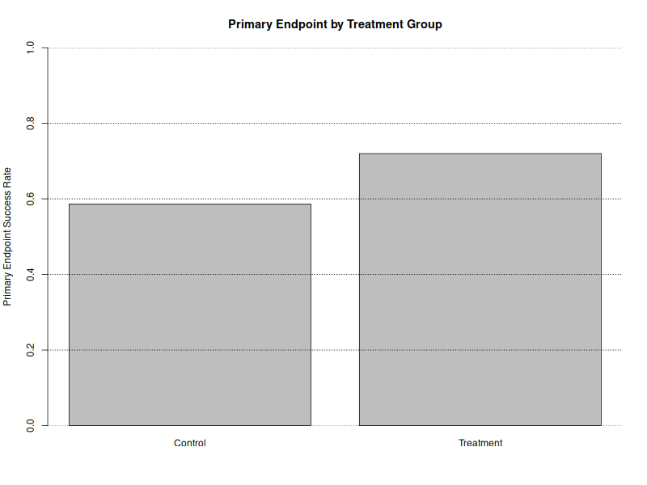

# Randomized Clinical Trial Analysis

## Overview

This project demonstrates an end-to-end statistical analysis of a hypothetical randomized controlled clinical trial using R.

The workflow includes simulation of subject-level clinical trial data, baseline summaries, primary endpoint analysis, treatment-effect estimation, and generation of reproducible statistical outputs.

All data are simulated and are intentionally small in order to demonstrate clinical biostatistics and statistical programming methods.

## Study Design

- Study design: Prospective, randomized, two-arm clinical trial
- Sample size: 300 participants
- Treatment allocation: 1:1
- Treatment group: Investigational treatment (n = 150)
- Control group: Standard treatment (n = 150)
- Primary endpoint: Binary clinical success outcome
- Analysis population: Intent-to-treat (ITT)

## Primary Objective

The primary objective is to compare the proportion of participants achieving clinical success between the investigational treatment and control groups.

Treatment effect is evaluated using:

- Success rates by randomized treatment group
- Absolute risk difference
- 95% confidence interval
- Two-sided hypothesis test

## Primary Endpoint Results

| Measure | Result |
|---|---:|
| Treatment success | 108/150 (72.0%) |
| Control success | 88/150 (58.7%) |
| Risk difference | 13.3% |
| 95% CI | 2.7% to 24.0% |
| P-value | 0.0153 |

The simulated trial therefore produced an estimated absolute treatment effect of 13.3 percentage points in favor of the investigational treatment.

## Baseline Characteristics

Baseline characteristics were summarized by randomized treatment group to demonstrate a typical clinical trial Table 1 workflow.

Variables include:

- Age
- Sex
- Baseline clinical score

Categorical variables are summarized using counts and percentages, while continuous variables are summarized using means and standard deviations.

## Statistical Methods

The primary binary endpoint was analyzed by comparing success proportions between randomized treatment groups.

The absolute risk difference was calculated as:

`Treatment success rate - Control success rate`

A two-sided 95% confidence interval was calculated for the treatment difference, together with a hypothesis test of no difference between treatment groups.

All analyses were conducted using the intent-to-treat principle.

## Treatment Effect

The figure displays the observed primary endpoint success rates in the simulated treatment and control groups.

## Reproducible Workflow

The analysis is separated into data-generation and analysis programs to mimic a reproducible clinical statistical programming workflow:

1. Generate a synthetic randomized clinical trial dataset.
2. Save the subject-level analysis dataset.
3. Read the dataset into the analysis program.
4. Generate baseline characteristics.
5. Perform the primary endpoint analysis.
6. Export analysis-ready tables and figures.

## Files

- `simulate_rct_data.R` — generates the simulated randomized clinical trial dataset
- `analyze_rct.R` — performs baseline and primary endpoint analyses
- `rct_data.csv` — simulated subject-level clinical trial dataset
- `baseline_table.csv` — baseline characteristics by randomized treatment group
- `primary_endpoint.csv` — primary efficacy analysis results
- `treatment_effect.png` — visualization of primary endpoint success rates
- `README.md` — project documentation

## Skills Demonstrated

- Randomized clinical trial analysis
- Intent-to-treat analysis
- Clinical data simulation
- Baseline characteristic tables
- Binary endpoint analysis
- Risk-difference estimation
- Confidence interval estimation
- Hypothesis testing
- Reproducible R programming
- Clinical trial reporting

## Disclaimer

This project uses entirely simulated data. It does not contain patient data, proprietary clinical trial data, or results from an actual clinical study.
